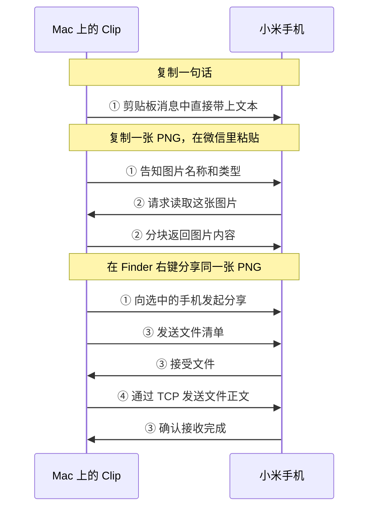

# Mi Clip 怎样把剪贴板和文件送到小米手机

在 Mac 上复制一句话，手机可以直接粘贴。把一句话换成一张图片，手机要再向 Mac 取一次内容。即使是同一张图片，改用 Finder 右键分享，文件正文又会走 TCP。这三种操作都从同一个已认证的设备会话开始，后续步骤由你选择的操作决定。

## 一、KCP 和 UDP 各做什么

UDP 是传输层协议。Clip 把一个数据报交给操作系统，指定手机的 IP 地址和端口，系统就可以发出它。接连发出几个数据报时，它们可能丢失、重复或乱序到达。KCP 在应用进程里给数据段编号、跟踪接收确认（ACK）、重传缺失的数据，并按顺序交给上层。在 Clip 中，KCP 把实际收发交给 UDP 套接字，这就是 **KCP/UDP** 的含义。[UDP 规范](https://www.rfc-editor.org/rfc/rfc768) · [KCP 官方文档](https://github.com/skywind3000/kcp)

比如，一条消息拆成三段，手机先收到第 1、3 段。接收端可以确认已经收到的段，暂存第 3 段。发送端重传第 2 段后，接收端就能按 1、2、3 拼回消息，再交给剪贴板处理。Clip 的主连接用一个精简的 KCP 实现处理分片、确认和重传，文件相关的 KCP 通道使用 Rust 的 `kcp` 库。[主连接的收发实现](../src/transport.rs#L43) · [剪贴板文件通道](../src/file_channel.rs#L339)

以短文本为例，Clip 先把 UTF-8 文本封装为剪贴板消息，用 AES-GCM 加密并生成认证标签，再交给 KCP/UDP 发送。接收端按相反顺序处理，先重组消息，再解密、验证标签，最后写入系统剪贴板。打包保留了消息类型和长度，传输过程没有额外的压缩步骤。[消息封装](../src/message_center.rs#L123) · [加解密与剪贴板同步](../src/handshake.rs#L1424)

## 二、Mac 怎样发现手机并建立连接

1. **发现服务。** 手机开启小米互联，Mac 在 Clip 面板开启“局域网设备”。Clip 通过 macOS 的 DNS-SD 接口，在本地网络用多播 DNS（mDNS）查找 `_lyra-mdns._udp` 服务。手机公布服务后，Mac 就能在同一局域网内发现它。[DNS-SD 规范](https://www.rfc-editor.org/rfc/rfc6763) · [Clip 的设备发现实现](../src/discovery.rs#L235)
2. **找到连接地址。** macOS 解析服务得到主机名和 TXT 记录。Clip 从 TXT 记录的 `AppData` 中读出手机公布的 KCP 端口，把主机名解析成网络地址，并排除 Mac 自己的地址。此时面板可以显示“已发现 · 等待连接”，即使双方尚未验证身份。[服务记录解析](../src/discovery.rs#L107) · [设备列表状态](../src/devices.rs#L87)
3. **验证身份，建立会话。** Clip 向手机公布的端口发起握手。双方交换临时公钥和设备凭据，Clip 验证对端证书属于同一小米账号、握手签名有效，并确认双方导出了相同的会话密钥。主连接就绪后，面板显示“已连接 · 认证通过”，此时可以同步剪贴板或发起分享。每台设备单独连接和重试，Finder 分享交给你选中的那台手机。[设备握手](../src/handshake.rs#L380) · [多设备连接管理](../src/worker.rs#L28)

## 三、三种操作怎样使用四类通道

这里按一台 Mac 与一台手机之间的**传输职责**计数。mDNS 负责前面的发现阶段。认证后的主连接可以持续使用，其余通道在取用剪贴板内容或发起文件分享时按需建立。

| 通道 | 承载协议 | 实际传什么 |
| --- | --- | --- |
| ① 主连接 | KCP/UDP | 双向短文本的正文（每条最多 3072 个 UTF-8 字节）、剪贴板图片或文件的可用通知，以及发起分享的请求。[主连接实现](../src/handshake.rs#L911) |
| ② 剪贴板数据通道 | KCP/UDP | 手机通过 `universalClipboard` 服务请求图片或文件。Mac 按请求读取字节，加密后分块发送，手机应用可以据此粘贴或显示预览。[按需发送](../src/file_channel.rs#L339) |
| ③ 文件分享控制通道 | KCP/UDP | Finder 右键分享使用 `miLyraShareTransfer` 服务。双方在控制通道上协商 TCP 连接、交换文件清单，并传递接收与完成确认。[分享协商](../src/share_sender.rs#L256) |
| ④ 文件分享数据通道 | TCP | 手机接受分享、文件流就绪后，Mac 把文件正文分块加密，通过协商好的 TCP 连接发给手机。[文件发送](../src/share_sender.rs#L438) · [文件块的加解密](../src/file_stream.rs#L129) |

下面从同一台 Mac 看三次操作。箭头旁的编号对应上表，表示每条消息实际走哪条通道。

这也解释了两个容易混淆的时刻。复制一张图片后，Clip 显示“图片已就绪”表示手机可以来取，图片字节要等到手机请求时才发送。用 Finder 分享时，即使 Mac 已把所有字节写入 TCP，Clip 仍会等待手机通过控制通道确认接收完成，才把这次分享标记为成功。[剪贴板状态](../src/worker.rs#L159) · [分享完成确认](../src/share_sender.rs#L618)
